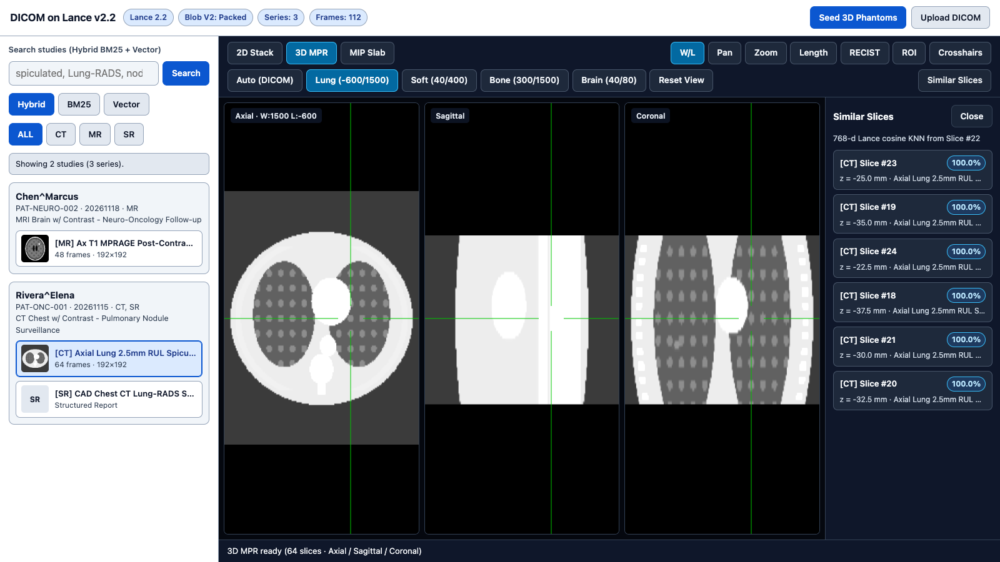
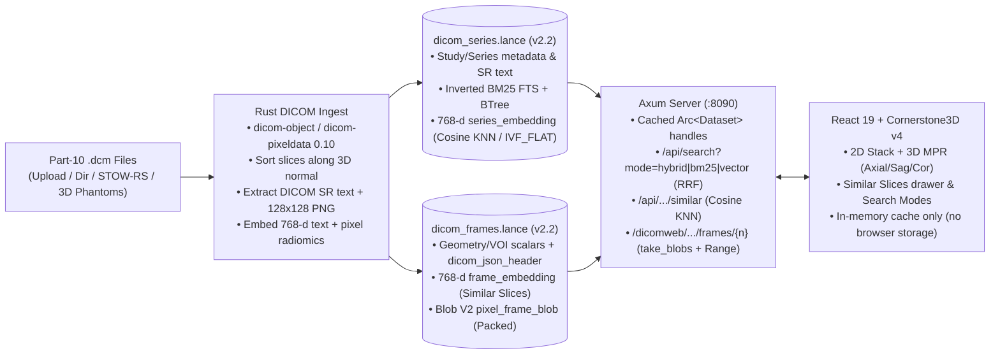

# dicom-lance

[](https://github.com/brucearctor/dicom-lance/actions/workflows/ci.yml)
[](LICENSE)

End-to-end **DICOM Part-10 ingestion**, **Lance v2.2 (`Blob V2`) multimodal storage + Hybrid BM25 & 768-d Vector Search**, **DICOMweb (`STOW-RS`, `QIDO-RS`, `WADO-RS`)**, and a **React 19 + TypeScript + Cornerstone3D v4** 2D Stack & 3D MPR workstation.



## Architecture



## Lance v2.2 Two-Dataset Schema

1. **`dicom_series.lance`** (`data/lance/dicom_series.lance`):
   - Primary merge key: `(study_instance_uid, series_instance_uid)`.
   - Indexed with Lance `Inverted` BM25 FTS (`searchable_text_fts` with positions), `BTree` scalar indexes (`study_instance_uid`, `modality`), and `IVF_FLAT` vector index on `series_embedding` (at `>= 256` rows; exact Cosine KNN below threshold).
   - Holds `sr_text` (extracted from `DICOM SR` `ContentSequence`), `thumbnail_png`, spacing/VOI defaults, and `series_embedding` (`FixedSizeList<Float32, 768>`).
2. **`dicom_frames.lance`** (`data/lance/dicom_frames.lance`):
   - Primary merge key: `(study_instance_uid, series_instance_uid, sop_instance_uid, frame_number)`.
   - Indexed with `BTree` scalar indexes (`study_instance_uid`, `series_instance_uid`, `sop_instance_uid`) and `IVF_FLAT` vector index on `frame_embedding` (`>= 256` rows).
   - Physically sorted along slice normal `cross(row_cosines, col_cosines)`.
   - Projects `dicom_json_header` (`PixelData` stripped, `"00020010"` TransferSyntaxUID injected) for fast WADO-RS metadata reads without touching pixel payloads.
   - Stores decoded frames out-of-line in **`pixel_frame_blob`** (`lance::blob::blob_field_with_options` with `4 KiB` inline threshold -> `BlobKind::Packed` sidecar files), served via cached `Dataset` handles, `Dataset::take_blobs`, and `BlobFile::read` / `BlobFile::read_range`.

## Multimodal Embeddings, Hybrid Search & Cloud Storage

- **Hybrid Search (`Hybrid` / `BM25` / `Vector`)**: Combines Lance BM25 full-text search with 768-d cosine KNN vector search via Reciprocal Rank Fusion (`k = 60`), supporting subword/semantic recall (e.g., `"nodular"` -> Chest CT / Lung-RADS SR) as well as exact clinical tags.
- **Find Similar Slices**: Queries `frame_embedding` via Lance `Scanner::nearest` (`MetricType::Cosine`) at `GET /api/studies/{study}/series/{series}/instances/{sop}/frames/{frame}/similar` and provides click-to-jump slice navigation in the viewer.
- **Pluggable Embedder**: Uses a pure-Rust deterministic `local-multimodal-768` embedder (512-d text n-gram hashing + 256-d pixel radiomics/spatial descriptors) by default, or any OpenAI-compatible `/v1/embeddings` endpoint via `--embedder-url` (`EMBEDDER_URL`), `--embedder-model`, and `--embedder-api-key`.
- **Cloud & Remote Object Storage**: Supports local paths, `file://`, `shared-memory://`, and `memory://` out of the box via `--dataset-uri` (`DATASET_URI`). Enable native S3/GCS/Azure object stores at compile time with `--features cloud` (`cloud-s3`, `cloud-gcs`, `cloud-azure`; requires `cmake` for `aws-lc-rs`).

## Quickstart

### Local Build

```bash
# 1. Build the TypeScript Cornerstone3D frontend
cd web && npm install && npm run build && cd ..

# 2. Run the Rust server and auto-seed the 3D CT (+ Lung-RADS SR) & Brain MRI phantoms
cargo run --release -- --seed-on-start --port 8090 --data-dir ./data
```

### Docker Quickstart

```bash
# Run the published container image from GHCR (amd64)
docker run --rm -p 8090:8090 -e SEED_ON_START=true ghcr.io/brucearctor/dicom-lance:latest

# Or build locally
docker build -t dicom-lance .
docker run --rm -p 8090:8090 -e SEED_ON_START=true dicom-lance
```

Open **http://127.0.0.1:8090** in your browser.

### Example `curl` Commands

```bash
# Lance telemetry (confirms v2.2, BM25 FTS index, and Packed Blob V2)
curl -s http://127.0.0.1:8090/api/stats | jq

# Hybrid BM25 + 768-d vector search across DICOM metadata, SR findings & radiomics
curl -s "http://127.0.0.1:8090/api/search?q=spiculated+right+upper+lobe&mode=hybrid" | jq

# Cosine KNN "Find Similar Slices" for Chest CT nodule slice 23
curl -s "http://127.0.0.1:8090/api/studies/1.2.826.0.1.3680043.10.5432.1001/series/1.2.826.0.1.3680043.10.5432.1001.1/instances/1.2.826.0.1.3680043.10.5432.1001.1.23/frames/1/similar?limit=5" | jq

# WADO-RS series metadata (projects JSON column only; zero blob I/O)
curl -s "http://127.0.0.1:8090/dicomweb/studies/1.2.826.0.1.3680043.10.5432.1001/series/1.2.826.0.1.3680043.10.5432.1001.1/metadata" | jq 'length'

# WADO-RS frame byte-range read via Lance BlobFile::read_range
curl -i -H "Range: bytes=0-1023" \
  "http://127.0.0.1:8090/dicomweb/studies/1.2.826.0.1.3680043.10.5432.1001/series/1.2.826.0.1.3680043.10.5432.1001.1/instances/1.2.826.0.1.3680043.10.5432.1001.1.23/frames/1"
```

## Test Suites

```bash
# Rust Hegel PBT (`hegeltest`: MIME round-trip, HTTP Range/u64::MAX, SQLi validation,
# 3D oblique slice permutation invariance, thumbnail rendering, SR recursion, Lance Blob V2 oracle)
# + end-to-end & negative/error-path integration tests
cargo test --locked

# Frontend TypeScript check, production build, and Vitest + `@hegeldev/hegel` PBT suite
cd web
npm run build
npm test

# Install Chromium once if not using a preinstalled binary (or set PLAYWRIGHT_CHROMIUM_EXECUTABLE_PATH)
npx playwright install chromium

# Hermetic Playwright E2E + axe-core WCAG 2.2 AA + zero browser storage
npm run test:e2e

# Live Rust + Lance v2.2 + Cornerstone3D WebGL2 E2E (requires `cargo build --locked` first)
npm run test:e2e:live
```

## Security & Clinical Disclaimer

- **Research / Non-Diagnostic Use Only**: `dicom-lance` is an experimental reference implementation. It is **not** FDA-cleared, CE-marked, or intended for primary clinical diagnosis.
- **Network Exposure**: By default the HTTP server binds to `127.0.0.1:8090` with permissive CORS and **no built-in authentication**. Place it behind TLS, authentication, and authorization before serving real patient data or exposing it beyond localhost. See [SECURITY.md](SECURITY.md) for deployment guidance.

## Contributing, Changelog & License

See [CHANGELOG.md](CHANGELOG.md) for release notes. Contributions are welcome — see [CONTRIBUTING.md](CONTRIBUTING.md).

Licensed under the [Apache License, Version 2.0](LICENSE).
