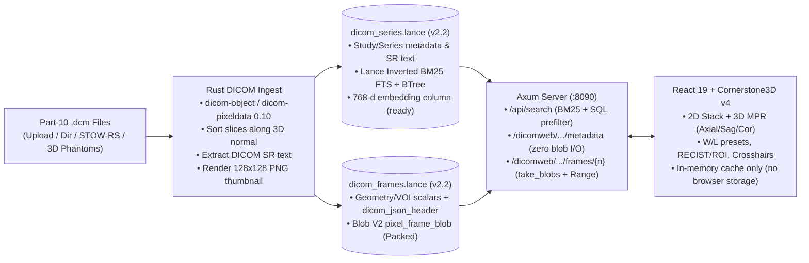

# dicom-lance

End-to-end **DICOM Part-10 ingestion**, **Lance v2.2 (`Blob V2`) multimodal storage + BM25 Full-Text Search**, **DICOMweb (`STOW-RS`, `QIDO-RS`, `WADO-RS`)**, and a **React 19 + TypeScript + Cornerstone3D v4** 2D Stack & 3D MPR workstation.

## Architecture



## Lance v2.2 Two-Dataset Schema

1. **`dicom_series.lance`** (`data/lance/dicom_series.lance`):
   - Primary merge key: `(study_instance_uid, series_instance_uid)`.
   - Indexed with Lance `Inverted` BM25 FTS (`searchable_text_fts` with positions) and `BTree` scalar indexes (`study_instance_uid`, `modality`).
   - Holds `sr_text` (extracted from `DICOM SR` `ContentSequence`), `thumbnail_png`, spacing/VOI defaults, and nullable `series_embedding` (`FixedSizeList<Float32, 768>`).
2. **`dicom_frames.lance`** (`data/lance/dicom_frames.lance`):
   - Primary merge key: `(study_instance_uid, series_instance_uid, sop_instance_uid, frame_number)`.
   - Physically sorted along slice normal `cross(row_cosines, col_cosines)`.
   - Projects `dicom_json_header` (`PixelData` stripped, `"00020010"` TransferSyntaxUID injected) for fast WADO-RS metadata reads without touching pixel payloads.
   - Stores decoded frames out-of-line in **`pixel_frame_blob`** (`lance::blob::blob_field_with_options` with `4 KiB` inline threshold -> `BlobKind::Packed` sidecar files), served via `Dataset::take_blobs` and `BlobFile::read` / `BlobFile::read_range`.

## Quickstart

```bash
# 1. Build the TypeScript Cornerstone3D frontend
cd web && npm install && npm run build && cd ..

# 2. Run the Rust server and auto-seed the 3D CT (+ Lung-RADS SR) & Brain MRI phantoms
cargo run --release -- --seed-on-start --port 8090 --data-dir ./data
```

Open **http://127.0.0.1:8090** in your browser.

### Example `curl` Commands

```bash
# Lance telemetry (confirms v2.2, BM25 FTS index, and Packed Blob V2)
curl -s http://127.0.0.1:8090/api/stats | jq

# BM25 full-text search across DICOM metadata + SR findings
curl -s "http://127.0.0.1:8090/api/search?q=spiculated+right+upper+lobe" | jq

# WADO-RS series metadata (projects JSON column only; zero blob I/O)
curl -s "http://127.0.0.1:8090/dicomweb/studies/1.2.826.0.1.3680043.10.5432.1001/series/1.2.826.0.1.3680043.10.5432.1001.1/metadata" | jq 'length'

# WADO-RS frame byte-range read via Lance BlobFile::read_range
curl -i -H "Range: bytes=0-1023" \
  "http://127.0.0.1:8090/dicomweb/studies/1.2.826.0.1.3680043.10.5432.1001/series/1.2.826.0.1.3680043.10.5432.1001.1/instances/1.2.826.0.1.3680043.10.5432.1001.1.23/frames/1"
```

## Test Suites

```bash
# Rust integration tests (STOW-RS, Lance v2.2 BlobKind::Packed, BM25 FTS, WADO-RS & HU fidelity)
cargo test

# Frontend TypeScript check, production build, and Vitest unit tests
cd web
npm run build
npm test

# Install Chromium once if not using a preinstalled binary (or set PLAYWRIGHT_CHROMIUM_EXECUTABLE_PATH)
npx playwright install chromium

# Hermetic Playwright E2E + axe-core WCAG 2.2 AA + no browser storage
npm run test:e2e

# Live Rust + Lance v2.2 + Cornerstone3D WebGL2 E2E (requires `cargo build` first)
npm run test:e2e:live
```

## Security & Clinical Disclaimer

- **Research / Non-Diagnostic Use Only**: `dicom-lance` is an experimental reference implementation. It is **not** FDA-cleared, CE-marked, or intended for primary clinical diagnosis.
- **Network Exposure**: By default the HTTP server binds to `127.0.0.1:8090` with permissive CORS and **no built-in authentication**. Place it behind TLS, authentication, and authorization before serving real patient data or exposing it beyond localhost.

## License

Licensed under the [Apache License, Version 2.0](LICENSE).
